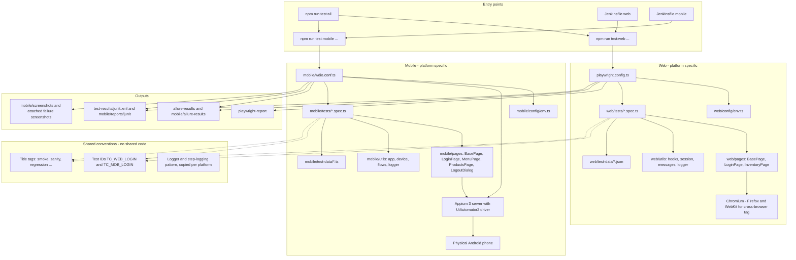
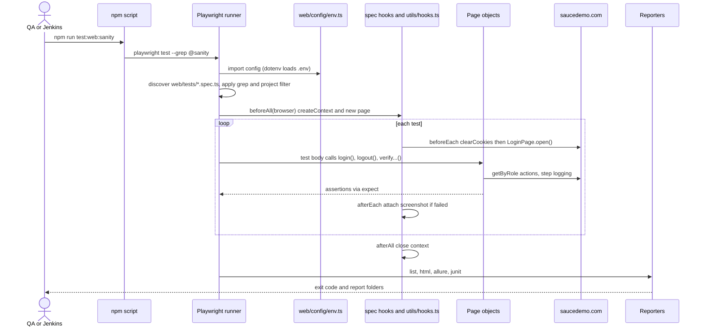
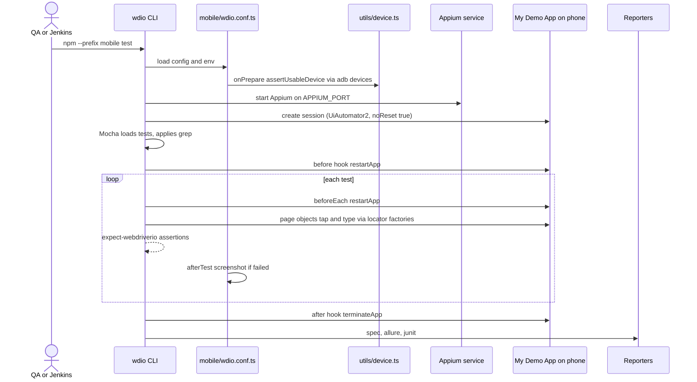
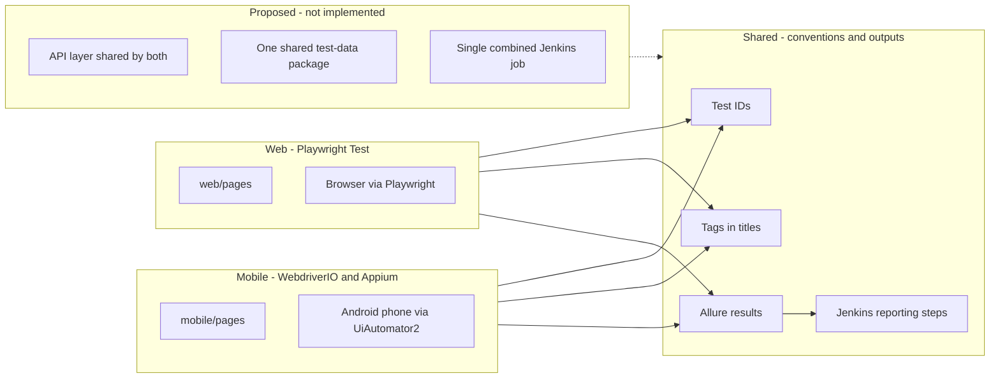
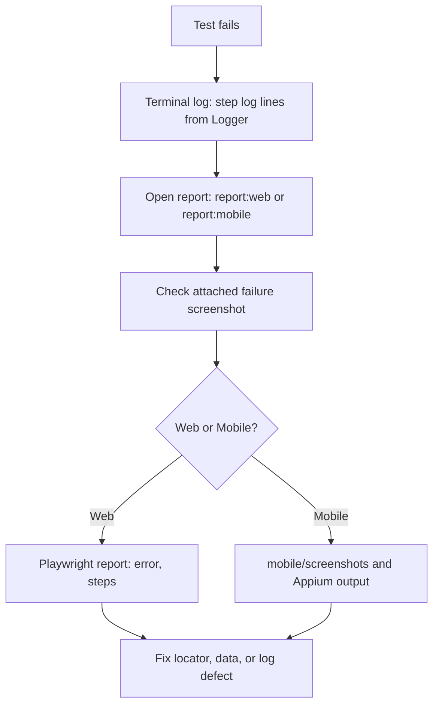
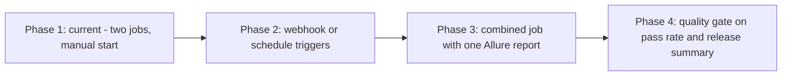

# QA Automation Project - Architecture and Knowledge Transfer (KT)

Project: SnapWork - Login automation for US_LOGIN_001 (Web: SauceDemo, Mobile: Sauce Labs My Demo App for Android)
Document date: 2026-10-13
Basis: repository review of `/SnapWork` (source, configs, Jenkinsfiles, agents, result folders). No application code, tests or pipeline files were changed while preparing this document.

Evidence labels used throughout:

| Label | Meaning |
|---|---|
| Verified | Confirmed by reading the file named, or by result artifacts present in the repo |
| Inferred | Follows from the configuration but was not observed running |
| Proposed Improvement | Not implemented; a recommendation |
| Not Found | Searched for and absent from the repository |
| Needs Confirmation | Cannot be decided from the repository alone |

---

## Section 1: Executive Summary

### Purpose
The project automates and documents the **Login / Logout** feature (user story `US_LOGIN_001`) for two applications:

- **Web**: https://www.saucedemo.com (demo shop), tested in browsers.
- **Mobile**: Sauce Labs My Demo App, a native Android app, tested on a physical Android phone.

It was built as a QA Manager assignment: test-case design, a web framework, a mobile framework, Jenkins CI integration and documentation.

### What exists today (Verified)

| Capability | Status | Evidence |
|---|---|---|
| Written test cases (Web + Mobile) with Manual / Automation / Both split | Implemented as data, workbook output needs confirmation | `test-cases/test-cases.new.json` (66 cases), `test-cases/generate-excel.new.ts` |
| Web automation (Playwright + TypeScript, Page Object Model) | Implemented | `web/`, `playwright.config.ts` |
| Mobile automation (WebdriverIO + Appium, Page Object Model) | Implemented, end-to-end pass status not confirmed in this review | `mobile/`, `mobile/wdio.conf.ts` |
| Jenkins pipelines for Web and Mobile | Written; Web job built successfully (per Jenkins screenshot); Mobile job status Needs Confirmation | `jenkins/Jenkinsfile.web`, `jenkins/Jenkinsfile.mobile` |
| Reports: Playwright HTML, Allure, JUnit | Implemented | `playwright.config.ts`, `mobile/wdio.conf.ts` |
| Combined Web + Mobile Allure report | Implemented as an npm script | `package.json` -> `report:all` |
| AI-assisted workflow (custom Copilot agents + MCP config) | Implemented as instruction files | `.github/agents/*.agent.md`, `.vscode/mcp.example.json` |
| API testing | **Not Found** | No API client, service or API test in the repo |
| Role-based login / authentication state reuse | **Not Found** | Single demo user set only |

### Benefits for stakeholders
- **QA**: repeatable login regression in minutes instead of manual clicks; failures come with screenshots.
- **Developers**: fast feedback on login/logout regressions and documented application defects.
- **Release management**: pass/fail evidence in Jenkins with downloadable reports.
- **Managers**: one command runs both platforms and one report combines the results.

### Known limitations (summary)
- The mobile application accepts any non-empty credentials; four mobile tests and one web test are marked known issues (`@known-issue`) and assert the *expected* behavior.
- Mobile runs need a physical phone connected to the machine that runs the tests.
- No API layer, no role-based tests, no QA/UAT environment switching (only `BASE_URL`).
- The workbook generator is in a transitional state (`.new` files side by side with the old generator).

---

## Section 2: Technology Stack

| Technology | What it does | Why used | Where configured | Depends on it | Status |
|---|---|---|---|---|---|
| Node.js + npm | Runs tooling and test runners | Both frameworks are TypeScript | `package.json`, `mobile/package.json` | Everything | Verified |
| TypeScript (strict) | Typed test code | Early error detection | `tsconfig.json`, `mobile/tsconfig.json` | `web/**`, `mobile/**` | Verified |
| Playwright Test | Web test runner + browser automation | Auto-waiting, reporters, parallelism | `playwright.config.ts` | `web/tests/*.spec.ts` | Verified |
| WebdriverIO 9 + Mocha | Mobile test runner | Standard Appium client for TypeScript | `mobile/wdio.conf.ts` | `mobile/tests/*.spec.ts` | Verified |
| Appium 3 + UiAutomator2 driver | Controls the native Android app | Required by the assignment for mobile | `mobile/package.json` (`appium`, `appium-uiautomator2-driver`), `wdio.conf.ts` (appium service, capabilities) | Mobile suite | Verified |
| Page Object Model | Separates locators/actions from tests | Maintainability | `web/pages/*`, `mobile/pages/*` | All specs | Verified |
| dotenv | Loads `.env` values | Keep config out of code | `web/config/env.ts`, `mobile/config/env.ts` | Config modules | Verified |
| Custom Logger | Timestamped console log with levels | Visible step logs in the terminal | `web/utils/logger.ts`, `mobile/utils/logger.ts` | Page objects, hooks | Verified |
| Playwright HTML reporter | Interactive web report | Default Playwright report | `playwright.config.ts` | Web suite | Verified |
| Allure (`allure-playwright`, `@wdio/allure-reporter`, `allure-commandline`) | Report for both platforms | One combined report is possible | `playwright.config.ts`, `mobile/wdio.conf.ts`, `package.json` scripts | Both suites | Verified |
| JUnit reporters | XML for Jenkins test trend | Jenkins `junit` step | `playwright.config.ts`, `mobile/wdio.conf.ts` | Jenkins | Verified |
| Jenkins (local) | CI execution | Assignment requirement | `jenkins/Jenkinsfile.web`, `jenkins/Jenkinsfile.mobile` | CI | Verified (files); runs per Jenkins screenshot for Web |
| Git + GitHub | Source control, Jenkins checkout source | Jenkins job pulls from GitHub | `.gitignore`, Jenkins job config | CI | Verified |
| ExcelJS + tsx | Builds the test-case workbook | Assignment deliverable | `test-cases/package.json`, `test-cases/generate-excel*.ts` | Test design | Verified (code); output Needs Confirmation |
| GitHub Copilot custom agents + MCP | AI-assisted design and coding | AI-SDLC part of the assignment | `.github/agents/`, `.vscode/mcp.example.json` | Development workflow | Verified (files) |
| GitHub Actions | Legacy CI from the Playwright scaffold | Not designed for this project | `.github/workflows/playwright.yml` | None intended | Verified; see gaps |

Proposed (not implemented): API test layer, secrets manager integration, Docker image for CI, device farm.

---

## Section 3: Complete Project Folder Structure

Generated from the current repository (generated/ignored folders such as `node_modules/`, report folders are omitted).

```
SnapWork/
  package.json                  # root scripts: web, mobile, all, reports
  package-lock.json
  playwright.config.ts          # Playwright config (testDir ./web/tests)
  tsconfig.json                 # type-check web/ + playwright.config.ts
  .env.example                  # BASE_URL, HEADLESS, LOG_LEVEL
  .gitignore
  .github/
    copilot-instructions.md     # repository-wide Copilot instructions
    agents/                     # 9 custom agent files
    workflows/playwright.yml    # legacy scaffold CI (GitHub Actions)
  .vscode/
    mcp.example.json            # MCP server template (mcp.json is git-ignored)
  jenkins/
    Jenkinsfile.web
    Jenkinsfile.mobile
  web/                          # Playwright framework
    config/env.ts
    fixtures/pages.fixture.ts   # present but not imported by any spec
    pages/ BasePage.ts, LoginPage.ts, InventoryPage.ts
    test-data/ users.json, messages.json, login-cases.json
    tests/ login.spec.ts, logout.spec.ts, security.spec.ts, sanity.spec.ts
    utils/ hooks.ts, logger.ts, messages.ts, session.ts
  mobile/                       # WebdriverIO + Appium framework (own package, ESM)
    package.json, tsconfig.json, wdio.conf.ts, .env.example (local .env git-ignored)
    config/env.ts
    pages/ BasePage.ts, LoginPage.ts, MenuPage.ts, ProductsPage.ts, LogoutDialog.ts
    test-data/ users.ts, messages.ts
    tests/ login.spec.ts, logout.spec.ts
    utils/ app.ts, device.ts, flows.ts, logger.ts
  test-cases/
    package.json, tsconfig.json
    test-cases.new.json         # 66 test cases (source of truth, new schema)
    generate-excel.new.ts       # workbook generator (new schema)
    generate-excel.ts           # older generator (old schema)
    TestCases_Summary.xlsx      # a workbook; its generator is Needs Confirmation
  docs/
    ac-deviations.md            # AC vs actual behavior (Web live-verified, Mobile live-verified)
    evidence/web-login-page.png
    QA_AUTOMATION_PROJECT_ARCHITECTURE_AND_KT.md   # this file
  tests/example.spec.ts         # original Playwright scaffold, not executed (testDir is ./web/tests)
  pages/                        # empty folder at the root
```

### Responsibility of important files

| Path | Responsibility |
|---|---|
| `playwright.config.ts` | Test directory, parallelism, timeouts, reporters, screenshot/trace settings, projects `chromium`, `firefox`, `webkit` |
| `web/config/env.ts` | Loads root `.env`; exports `env.baseUrl`, `env.headless`, `env.logLevel`, `sessionCookieName` |
| `web/pages/BasePage.ts` | Holds `page` and `logger`; `navigateTo()` with logging |
| `web/pages/LoginPage.ts` | Login actions, error reading, `verify...` methods; locators created in constructor with `getByRole` |
| `web/pages/InventoryPage.ts` | Inventory checks and `logout()` via the burger menu |
| `web/utils/hooks.ts` | `createContext()` and `attachScreenshotOnFailure()` used by every spec |
| `web/utils/session.ts` | Cookie helpers for session tests (`session-username`) |
| `web/utils/messages.ts` | Builds expected error text from `web/test-data/messages.json` |
| `mobile/wdio.conf.ts` | WebdriverIO config: capabilities, Appium service, reporters, device pre-check, screenshot on failure |
| `mobile/utils/app.ts` | `restartApp()`, `terminateApp()`, `bringAppToFront()`, `expectKnownIssue()` |
| `mobile/utils/device.ts` | `assertUsableDevice()` fails fast when no device, wrong UDID, or a device name containing a space |
| `mobile/utils/flows.ts` | Shared page instances and `loginAsValidUser()` |
| `jenkins/Jenkinsfile.*` | Pipelines for each platform |
| `test-cases/*.json` / `generate-excel*.ts` | Test-case data and Excel generator |

### Differences from a "typical" framework (Verified)
- No `api/`, `services/`, `components/`, `types/`, `constants/`, `auth/`, `scripts/` folders exist.
- Web and Mobile are two separate Node packages with separate runners.
- `web/fixtures/pages.fixture.ts` exists but is not used (search found no imports).

---

## Section 4: High-Level Architecture Diagrams

### 4.1 Current architecture



### 4.2 Test lifecycle (Web)



### 4.3 Test lifecycle (Mobile)



---

## Section 5: End-to-End Execution Flow

### Web: `npm run test:web` (Verified from `package.json` -> `playwright test`)

| # | Step | File / module | Control passes to |
|---|---|---|---|
| 1 | Command | `package.json` script `test:web` | Playwright CLI |
| 2 | Env loading | `web/config/env.ts` calls `dotenv.config` on the root `.env`; defaults: `BASE_URL` = saucedemo, `HEADLESS` = true, `LOG_LEVEL` = info | `playwright.config.ts` |
| 3 | Config init | `playwright.config.ts`: `testDir ./web/tests`, `fullyParallel`, timeouts, reporters, `use` | Discovery |
| 4 | Discovery | all `web/tests/*.spec.ts` | Filters |
| 5 | Tag/project filter | `--grep` on the full test title; `firefox`/`webkit` projects only match `@cross-browser` | Workers |
| 6 | Fixtures | No custom fixtures are used. Specs use `browser` from Playwright and their own `beforeAll` | Hooks |
| 7 | Auth/test data | No login state is reused. Each test logs in through the UI; data from `web/test-data/*.json` | Browser setup |
| 8 | Browser setup | `utils/hooks.ts` `createContext()` -> `browser.newContext({ baseURL, viewport 1280x720 })`; one page per describe per worker | Test body |
| 9 | Page interactions | `LoginPage`, `InventoryPage` methods; each logs start, success, failure | Assertions |
| 10 | API requests | **Not Found** | - |
| 11 | Assertions | `expect`, `expect.poll`; page `verify...` methods | Teardown |
| 12 | Cleanup | `afterEach` screenshot on failure; `afterAll` closes the context; `beforeEach` clears cookies for the next test | Reporting |
| 13 | Reports | reporters in `playwright.config.ts`: list, html -> `playwright-report/`, allure -> `allure-results/`, junit -> `test-results/junit.xml` | Exit code |
| 14 | Failure artifacts | screenshot attached by `attachScreenshotOnFailure`; see Section 12 about trace/video | Debugging |

### Mobile: `npm run test:mobile` (Verified from `package.json` -> `npm --prefix mobile test` -> `wdio run wdio.conf.ts`)

| # | Step | File / module |
|---|---|---|
| 1 | Command | `mobile/package.json` script `test` |
| 2 | Env loading | `mobile/config/env.ts` (`dotenv/config` reads `mobile/.env` from the working directory); keys: `ANDROID_UDID`, `DEVICE_NAME`, `APP_PACKAGE`, `APP_ACTIVITY`, `APP_PATH`, `APPIUM_PORT`, `LOG_LEVEL` |
| 3 | Config init | `mobile/wdio.conf.ts`: capabilities, `waitforTimeout`, services, reporters, Mocha options |
| 4 | Pre-flight | `onPrepare` -> `assertUsableDevice()` runs `adb devices`; fails with a clear message if no device, unknown `ANDROID_UDID` or a space in the device name |
| 5 | Appium | `@wdio/appium-service` starts Appium 3 on `APPIUM_PORT`; the UiAutomator2 driver must be installed (`npm run setup` in `mobile/`) |
| 6 | Session | capabilities: `UiAutomator2`, `appPackage`, `appActivity`, `appWaitActivity '*'`, `noReset true`, `autoGrantPermissions true` |
| 7 | Discovery/filter | `./tests/**/*.spec.ts`; `--mochaOpts.grep` on the test title |
| 8 | Hooks | `before` (log + `restartApp`), `beforeEach` (`restartApp`, logout spec also `loginAsValidUser`), `after` (`terminateApp`) |
| 9 | Screen interactions | `mobile/pages/*`; locators are factories (`() => $()`), evaluated at use |
| 10 | Assertions | `expect` from `@wdio/globals` (expect-webdriverio) |
| 11 | Known issues | `expectKnownIssue(reason, fn)` passes while a defect exists |
| 12 | Failure artifacts | `afterTest` writes `mobile/screenshots/*.png` and attaches to Allure |
| 13 | Reports | spec (console), Allure -> `mobile/allure-results/`, JUnit -> `mobile/reports/junit/results-<cid>.xml` |

---

## Section 6: How Web and Mobile Automation Work Together

### Current design (Verified)
- **Web** uses **Playwright Test** and drives a **browser** against https://www.saucedemo.com.
- **Mobile** uses **WebdriverIO + Mocha + Appium (UiAutomator2)** to drive a **native Android application** on a real phone. This is native-app automation, not mobile-browser testing. Playwright is **not** used for the native app.
- They use **separate runners and separate Node packages**: root package (CommonJS, Playwright) and `mobile/` package (`"type": "module"`, because WebdriverIO 9 is ESM-only).

### What is shared and what is not

| Aspect | Shared? | How |
|---|---|---|
| Test IDs (`TC_WEB_LOGIN_nnn`, `TC_MOB_LOGIN_nnn`) | Shared convention | Titles match the Excel / JSON |
| Tag names (`@smoke`, `@regression`, `@negative`, `@security`, `@known-issue`) | Shared convention | Written in test titles |
| Logger and step-logging pattern | Duplicated code | `web/utils/logger.ts` and `mobile/utils/logger.ts` are near-identical |
| Environment config | Separate | `.env` at root (web) and `mobile/.env` |
| Test data | Separate | JSON for web, TypeScript modules for mobile |
| API utilities | **Not Found** | No API layer exists to share |
| Authentication | Separate | Both log in through the UI with public demo credentials from the assignment; no role handling |
| Reports | Combinable | Both write Allure results; `npm run report:all` merges `allure-results/` and `mobile/allure-results/` |
| CI | Separate jobs | One Jenkinsfile per platform |

### Independent and combined execution
- Independent: `npm run test:web` and `npm run test:mobile` (Verified scripts).
- Combined locally: `npm run test:all` runs web, then mobile, and returns a non-zero code if either fails (`package.json`).
- Combined in Jenkins: **Not Implemented**. Two jobs exist; a combined job is a Proposed Improvement.
- Consolidated report: `npm run report:all` (local only).

### Authentication and roles
The demo apps have a fixed set of users. Web uses a valid user, a locked-out user and a performance-glitch user (`web/test-data/users.json`). Mobile uses a valid user, a locked-out user, an unknown user and a wrong-password case (`mobile/test-data/users.ts`). No role-based access, tokens or session reuse exist.



### Proposed integration strategy (Proposed Improvement)
1. Phase 1: add `jenkins/Jenkinsfile.all` that runs the web and mobile stages and publishes a combined Allure report.
2. Phase 2: move shared constants (messages, user definitions) into one JSON read by both projects.
3. Phase 3: add a small API client used by both to create or reset test state, if the applications expose an API (Unknown for these demo apps).

---

## Section 7: Framework Design and Design Patterns

| Pattern | Implementation (Verified) | Benefit | Limitation |
|---|---|---|---|
| Page Object Model (Web) | `web/pages/LoginPage.ts`, `InventoryPage.ts`, inheriting `BasePage`; locators created in the constructor with `getByRole`; no `private` members | Tests read as steps; one place to fix locators | Password input has no ARIA role, so it is reached by Tab from the Username field (comment in `LoginPage.enterPassword`) |
| Mobile page objects | `mobile/pages/*`; locators are factories (`ElementLocator = () => ChainablePromiseElement`) | Avoids stale elements after app restarts, because `$()` starts searching immediately | More verbose than stored elements |
| Fixtures / dependency injection | A fixture file exists (`web/fixtures/pages.fixture.ts`) but specs build page objects in `beforeAll` instead | Shared page per describe is fast | Fixture file is dead code; config `screenshot` and `trace` do not apply to pages created in `beforeAll` (see Section 12) |
| Hooks | Web: `beforeAll` / `afterAll` / `beforeEach` / `afterEach`; Mobile: Mocha `before` / `after` / `beforeEach` | Setup, cleanup and failure screenshots in one place | One page is shared across tests in a worker, so state isolation relies on `clearCookies` |
| API client pattern | **Not Found** | - | Gap |
| Logging | `Logger` class with levels; every page method logs start, success, failure (`logger.error` in `catch`, then rethrow) | Readable terminal trace; `LOG_LEVEL` controls noise; polled getters use `debug` | Logger and `describeError` are duplicated in two packages |
| Configuration | `env.ts` per platform, `.env.example` files | Environment values outside code | No QA/UAT profiles |
| Known-issue handling | Web: `test.fail(true, reason)` (`security.spec.ts`, `TC_WEB_LOGIN_027`); Mobile: `expectKnownIssue()` (`mobile/utils/app.ts`) | Suite stays green while defects exist, goes red when fixed | Reviewers must remember which tests are known issues |
| Fail-fast device check | `mobile/utils/device.ts` | Clear error instead of cryptic Appium failures | Only checks adb, not Appium |
| Data-driven tests | `for (const c of cases.mandatory / cases.invalid)` in `web/tests/login.spec.ts` from `web/test-data/login-cases.json` | Less duplication | Tags come from JSON strings |

### Duplication, coupling and observations (Verified)
- `web/utils/logger.ts` and `mobile/utils/logger.ts`, and the `LogLevel` parsing in both `env.ts` files, are duplicated.
- `web/fixtures/pages.fixture.ts` is unused.
- Root `tests/example.spec.ts` and the empty root `pages/` folder are leftovers.
- Each web spec repeats the same hook block (context, page, page objects).
- Page objects contain `verify...` methods with assertions, an intentional exception to the repository convention (see `.github/copilot-instructions.md`) so that `sanity.spec.ts` reads as a flow.

---

## Section 8: Test Tagging and Execution Strategy

Tags are plain words inside the **test title**. There is no `tag` property. Filtering is done with `grep` on the title.

### Tags found in the code (Verified by search)

| Tag | Purpose | Applies to | Example | Run command |
|---|---|---|---|---|
| `@smoke` | Core happy and critical negative paths | Web 8 tests, Mobile 7 tests | `TC_WEB_LOGIN_001 @smoke @sanity @regression ...` | Web: `npm run test:web:smoke`; Mobile: `npm run test:mobile:smoke` |
| `@sanity` | Quick check; the 8 web smoke tests plus 5 composite flows in `sanity.spec.ts` (13 tests) | Web only | `Sanity - login, inventory and logout flow ... @sanity` | `npm run test:web:sanity` |
| `@regression` | Full regression set | Web and Mobile | `TC_MOB_LOGIN_005 @regression ...` | Web: `npm run test:web:regression`; Mobile: `npm --prefix mobile run test:regression` |
| `@negative` | Negative scenarios | Web and Mobile | `TC_WEB_LOGIN_014 ... @negative ...` | `npx playwright test --grep @negative` |
| `@security` | Security-oriented checks | Web and Mobile | `TC_WEB_LOGIN_019 @security ...` | `npx playwright test --grep @security` |
| `@known-issue` | Defects that exist in the application | Web 1, Mobile 4 | `TC_MOB_LOGIN_009 ... @known-issue ...` | `npx playwright test --grep @known-issue` |
| `@cross-browser` | Run on Chromium, Firefox and WebKit | Web (`TC_WEB_LOGIN_034`) | `TC_WEB_LOGIN_034 @regression @cross-browser ...` | `npm run test:web:cross-browser` |

### Not found as tags
`@functional`, `@api`, `@mobile`, `@web`, `@critical`. Priority levels P0-P3 exist only in the Excel / JSON, not in the test titles.

### Combining tags (Inferred)
`--grep` accepts a regular expression, so `--grep "@smoke|@security"` runs either. To require both, use `--grep "(?=.*@smoke)(?=.*@security)"`. Not demonstrated in the repository.

### Tags vs projects vs file paths vs grep

| Mechanism | What it selects | Where defined |
|---|---|---|
| Tag | Words inside a title | Test titles and `web/test-data/login-cases.json` |
| `grep` | Regex match on the full title | npm scripts, Jenkinsfiles |
| Playwright project | Browser configuration (`chromium`, `firefox`, `webkit`) | `playwright.config.ts`. Firefox/WebKit also have `grep: /@cross-browser/` |
| File path | One spec file | `npx playwright test web/tests/login.spec.ts` |

### Inconsistencies and a proposed convention (Proposed Improvement)
- `@sanity` exists on web only; the mobile Jenkins job offers `all`, `smoke`, `regression` only.
- Tags are not enforced; a typo creates a new tag silently.
- Proposal: document the allowed list above, keep it in one `docs` table, and add a lint check for unknown `@` words.

---

## Section 9: Execution Commands and Operational Runbook

All commands run from the repository root unless stated. Status: **V** = script exists in `package.json` (Verified), **R** = also run by the team during setup, **I** = inferred, **P** = proposed.

### Setup

| Command | Purpose | Status |
|---|---|---|
| `npm install` | Install root (web) dependencies | V |
| `npx playwright install chromium` | Install the browser | V (used in Jenkinsfile) |
| `cd mobile && npm install` | Install mobile dependencies | V |
| `cd mobile && npm run setup` | `appium driver install uiautomator2` (needs Appium 3) | V |
| `cp mobile/.env.example mobile/.env` then edit | Set `ANDROID_HOME`, `ANDROID_UDID` | V |

### Run

| Goal | Command | Notes |
|---|---|---|
| All web tests | `npm run test:web` | Chromium, plus `@cross-browser` tests on Firefox/WebKit if those browsers are installed (V) |
| All mobile tests | `npm run test:mobile` | Phone connected and unlocked (V) |
| Web then mobile | `npm run test:all` | Both run even if web fails; exit code reflects both (V) |
| Smoke on both | `npm run test:all:smoke` | (V) |
| API tests | **Not Found** | No API suite |
| Web smoke / sanity / regression | `npm run test:web:smoke` / `test:web:sanity` / `test:web:regression` | (V; sanity run observed in Jenkins) |
| Mobile smoke | `npm run test:mobile:smoke` | (V) |
| Mobile regression | `npm --prefix mobile run test:regression` | No root alias exists |
| One web file | `npx playwright test web/tests/login.spec.ts` | (R) |
| One web test | `npm run test:web:one -- TC_WEB_LOGIN_001` | Script is `playwright test --grep` (V) |
| One mobile test | `npm --prefix mobile run test:one -- TC_MOB_LOGIN_003` | (V) |
| Headless | default (`HEADLESS=true`) | `web/config/env.ts` |
| Headed | `npm run test:web:headed` or `npm run test:web:sanity -- --headed` | (V) |
| Debug | `npm run test:web:sanity -- --debug` | The `--` is required (I) |
| Role-based run | **Not Found** | - |
| QA/UAT environment | **Not Found**; only `BASE_URL` in `.env` | `BASE_URL=<url> npm run test:web` is Inferred |
| Parallel | Web: `fullyParallel: true`, workers default locally, 2 in CI (`playwright.config.ts`); Mobile: `maxInstances: 1` | (V) |

### Reports and checks

| Goal | Command | Notes |
|---|---|---|
| Open Playwright HTML report | `npm run report:web` | (V) |
| Generate / open web Allure | `npm run allure:generate` then `npm run allure:open` | Needs Java (V) |
| Mobile Allure in one step | `npm run report:mobile` | (V) |
| Combined Allure | `npm run report:all` | (V) |
| TypeScript check (web) | `npm run typecheck` | Root `tsconfig.json` covers `web/` and `playwright.config.ts` (V) |
| TypeScript check (mobile) | `npm --prefix mobile run typecheck` | (V) |

### Troubleshooting entry points
See Section 15.

---

## Section 10: Test Data and Authentication

| Topic | Details |
|---|---|
| Web test data | `web/test-data/users.json` (valid, locked-out, performance-glitch users), `messages.json` (expected error texts), `login-cases.json` (data-driven rows and attack payloads) |
| Mobile test data | `mobile/test-data/users.ts`, `messages.ts` |
| Source of credentials | Public demo credentials supplied by the assignment. They are stored in the test-data files in the repository. Values are intentionally not reproduced in this document. |
| Environment variables | Web: `BASE_URL`, `HEADLESS`, `LOG_LEVEL` (`.env.example`). Mobile: `ANDROID_HOME`, `ANDROID_SDK_ROOT`, `ANDROID_UDID`, `DEVICE_NAME`, `APP_PACKAGE`, `APP_ACTIVITY`, `APP_PATH`, `APPIUM_PORT`, `LOG_LEVEL` (`mobile/.env.example`) |
| Secret management | `.env` files are git-ignored (`.gitignore`); `.env.example` files are tracked. No secrets manager is used. Jenkins takes `ANDROID_HOME` and `ANDROID_UDID` as build parameters, not credentials |
| Test user roles | Not Found beyond valid / locked-out / error users |
| Authentication state | Not reused. Each test logs in through the UI (web: `LoginPage.login`; mobile: `loginAsValidUser`) |
| Tokens / OTP / MFA | Not applicable; none present |
| Data setup and cleanup | Web: `context.clearCookies()` in `beforeEach`. Mobile: app restart (`restartApp`) in `beforeEach`, because the device denies `pm clear` and the app keeps login state in memory |
| Parallel conflicts | The demo apps have no server-side per-user data written by the tests, so conflicts are Unknown. Web contexts are per worker; mobile is single-instance |
| Local vs CI | Local: values from `.env`. CI: Jenkins sets `CI`, `HEADLESS`, `BASE_URL`, `LOG_LEVEL` (web) and `ANDROID_*` parameters (mobile) |
| Known blockers | Mobile needs a physical device. The demo mobile app accepts any non-empty credentials, so credential-validation tests assert behavior the app does not have (see `docs/ac-deviations.md`) |

---

## Section 11: API Testing Architecture

**Not Found.** The repository contains no API client, service classes, request payloads, schemas, token handling or API tests. `copilot-instructions.md` and `Code_Assistant_Lite.agent.md` mention API testing as a capability of the agent, but no implementation exists.

Capabilities not implemented: API setup/teardown for UI tests, status-code/schema checks, combined UI + API workflows, data-consistency checks.

Proposed Improvement: if the target applications expose usable endpoints (Unknown for the public demo apps), add a small API client (Playwright `APIRequestContext`) under `web/utils/api/` and call it from `beforeAll` or `beforeEach` to prepare state faster than UI steps.

---

## Section 12: Reporting and Test Results

### Web (Verified in `playwright.config.ts`)

| Reporter | Output | Purpose |
|---|---|---|
| `list` | Terminal | Live progress |
| `html` | `playwright-report/` (`open: 'never'`) | Interactive report with attachments |
| `allure-playwright` | `allure-results/` | Allure data |
| `junit` | `test-results/junit.xml` | Jenkins test trend |

Config also sets `screenshot: 'only-on-failure'`, `trace: 'retain-on-failure'`, `retries: 1` in CI (0 locally), `workers: 2` in CI. **Video is not configured.**

Important: the specs create their own context in `beforeAll` (`web/utils/hooks.ts` `createContext`). Playwright's `screenshot` and `trace` settings apply to contexts it creates itself, so they do **not** apply to these pages. Failure screenshots are produced by `attachScreenshotOnFailure` in `afterEach`. **No trace is captured for failures** (Inferred from the Playwright design; not observed).

### Mobile (Verified in `mobile/wdio.conf.ts`)

| Reporter | Output |
|---|---|
| `spec` | Terminal |
| `allure` | `mobile/allure-results/` |
| `junit` | `mobile/reports/junit/results-<cid>.xml` |

Failure screenshots: `afterTest` saves `mobile/screenshots/*.png` and attaches to Allure. No video, no Appium server log retention.

### Classification of results
- Passed / failed / skipped come from the Playwright, Mocha and JUnit outputs.
- Expected failures: web `test.fail` tests appear as passed ("expected failure"). Mobile `expectKnownIssue` tests appear as passed while the defect exists.
- Flaky: Playwright marks tests as flaky when they pass on retry (retries only in CI). Mobile has no retry (`Not Found` in config).

### Failure investigation flow



### Access
- Local: commands in Section 9.
- Jenkins: job page links "Playwright Report", "Web Allure Report", "Mobile Allure Report", "Latest Test Result", and archived artifacts (`jenkins/Jenkinsfile.*` `post { always { ... } }`). HTML reports require the Jenkins CSP setting to be relaxed (Needs Confirmation whether this was applied on your Jenkins).
- Combined: `npm run report:all` (local).

---

## Section 13: CI/CD and Release Integration

### Jenkins - Web (`jenkins/Jenkinsfile.web`, Verified)

| Item | Detail |
|---|---|
| Trigger | Manual "Build with Parameters". No SCM polling or webhook configured in the file |
| Source | `checkout scm` from the Git repository configured in the job (per Jenkins screenshot: GitHub, branch `main`) |
| Tools | `nodejs 'NodeJS-22'` (a Jenkins tool must exist with exactly this name) |
| Parameters | `TEST_SUITE` (all, sanity, smoke, regression), `TEST_ID`, `HEADLESS`, `ALL_BROWSERS` |
| Environment | `CI=true`, `HEADLESS`, `BASE_URL`, `LOG_LEVEL` |
| Stages | Checkout (cleans old results) -> Install (`npm ci`) -> Browsers (`npx playwright install chromium`, plus Firefox/WebKit if `ALL_BROWSERS`) -> Web tests (grep by suite or ID; chromium only unless `ALL_BROWSERS`) |
| Post | `junit test-results/junit.xml`; `npm run allure:generate`; `publishHTML` for Playwright and Allure; `archiveArtifacts` |
| Failure handling | A failing test returns a non-zero code and fails the build; reports are still published (`post always`) |
| Result evidence | Jenkins screenshot shows builds #4 and #5 successful with 13 tests (sanity) |

### Jenkins - Mobile (`jenkins/Jenkinsfile.mobile`, Verified file; run status Needs Confirmation)

| Item | Detail |
|---|---|
| Agent | `agent any`; must be the machine with the phone attached by USB (comment in the file) |
| Parameters | `TEST_SUITE` (all, smoke, regression), `TEST_ID`, `ANDROID_HOME`, `ANDROID_UDID` |
| Stages | Checkout -> Install (`npm ci` in `mobile/`) -> Appium driver (installs UiAutomator2 if missing) -> Device check (`adb devices`; fails if `ANDROID_HOME` empty) -> Mobile tests |
| Post | `junit mobile/reports/junit/*.xml`; Allure generate; `publishHTML`; archive screenshots and reports |
| Quality gates | None beyond pass/fail |

### Other CI
`.github/workflows/playwright.yml` is the original Playwright scaffold (GitHub Actions on push/PR to `main`/`master`, `npm ci`, `playwright install --with-deps`, `npx playwright test`, upload `playwright-report/`). It is **not** part of the designed solution. Whether it has run on GitHub is Unknown.

### Gaps (Verified)
No combined job, no trigger automation, no release-readiness report, no test retention policy other than `buildDiscarder` keeping 20 builds.

### Proposed phased design (Proposed Improvement)



---

## Section 14: Custom AI Agents and Development Workflow

### Files (Verified)

| Agent file | Name | Purpose | Tools declared |
|---|---|---|---|
| `qa-orchestrator.agent.md` | QA Orchestrator | Plans phases, hands work to the other agents | read, search, todo, agent; subagent list; 7 handoffs (each `send: false`) |
| `requirements-analyst.agent.md` | Requirements Analyst | Explore apps, validate credentials, write `docs/ac-deviations.md` | read, edit, search, web, playwright/*, appium/* |
| `test-designer.agent.md` | test-designer | Design cases, maintain JSON, generate Excel | read, edit, search, execute |
| `web-automation-engineer.agent.md` | Web Automation Engineer | Build/maintain the Playwright framework | read, edit, search, execute, playwright/* |
| `mobile-automation-engineer.agent.md` | Mobile Automation Engineer | Build/maintain the WebdriverIO + Appium framework | read, edit, search, execute, appium/* |
| `cicd-engineer.agent.md` | CI/CD Engineer | Jenkinsfiles and Jenkins jobs | read, edit, search, execute, jenkins/* |
| `qa-reviewer.agent.md` | QA Reviewer | Read-only review with Go / No-Go | read, search |
| `docs-writer.agent.md` | Docs Writer | README and framework docs | read, edit, search |
| `Code_Assistant_Lite.agent.md` | Code_Assistant_Lite | General coding agent for Playwright, Appium and API work | read, edit, search, appium/* |

Other AI configuration: `.github/copilot-instructions.md` (repository conventions and MCP description); `.vscode/mcp.example.json` (templates for `playwright`, `appium`, `github`, `jenkins` MCP servers; the real `mcp.json` is git-ignored).

### Workflow (from `qa-orchestrator.agent.md`)
1. Requirements: analyze acceptance criteria and real app behavior, write `docs/ac-deviations.md`.
2. Test design: cases in JSON, generate the Excel workbook.
3. Web automation, 4. Mobile automation, 5. Jenkins CI/CD, 6. Review, 7. Documentation.

### What the configuration does and does not provide
- Agents are used by a person in the chat; handoffs are buttons with `send: false`, so a human triggers each phase.
- Tool access is limited to the lists above. No agent in the files is configured to push code, deploy or run unattended.
- Human review: the files describe a Reviewer agent, but whether human sign-off occurred per phase is Needs Confirmation (it is not recorded in the repository).
- Documented limitations: some agent files differ from the current repository (for example the orchestrator names `test-cases/TestCases_Summary.xlsx` as the Phase 2 output while the generator writes `US_LOGIN_001_TestCases.xlsx`).

---

## Section 15: Failure Handling and Troubleshooting

### Confirmed project incidents (encountered while building this project)

| Symptom | Likely cause | Diagnostic | Resolution |
|---|---|---|---|
| `sh: wdio: command not found` | `npm install` not completed in `mobile/` | `ls mobile/node_modules/.bin` | Run `npm install` in `mobile/` |
| `ERESOLVE` on `expect-webdriverio` | `@wdio/globals` 9.x needs `expect-webdriverio` 6.x | npm error text | `mobile/package.json` now pins `^6.0.9` |
| `uiautomator2 cannot be installed ... server version` | UiAutomator2 driver requires Appium 3 | `npx appium --version` | `appium` set to `^3.0.0` |
| `Device adb-...(2)._adb-tls-connect._tcp was not in the list of connected devices` | Appium splits `adb devices` on whitespace; the wireless name contained a space | `adb devices` | Use a USB serial or `adb connect <ip>:<port>`; `mobile/utils/device.ts` now fails fast with this advice |
| `pm clear ... CLEAR_APP_USER_DATA` denied | Device blocks clearing app data | Appium error text | `appium:noReset: true` and `restartApp()` |
| Playwright: `First argument must use the object destructuring pattern: _fixtures` | `afterEach` callback signature | Jenkins/terminal output | Use `async ({}, testInfo)` (fixed in all four web specs) |
| Jenkins: `Unable to find Jenkinsfile.web` | Script Path missing `jenkins/` | Job configuration | Script Path `jenkins/Jenkinsfile.web` |
| Jenkins: repeated `npm install -g Checked` errors | Stray value in the NodeJS tool "Global npm packages" | Console output | Clear that field in Manage Jenkins > Tools |
| Jenkins first run used an empty suite | Parameters appear only after the first run | Console | Jenkinsfiles default an empty suite to `all` |
| `git add` fails: `mobile/ does not have a commit checked out` | A nested `.git` folder inside `mobile/` | `ls -a mobile` | Remove `mobile/.git` |

### General troubleshooting (Proposed guidance, not project incidents)

| Issue | Diagnostic | Resolution |
|---|---|---|
| Passes locally, fails in CI | Compare `HEADLESS`, Node version, browser install, `CI=true` (retries and workers differ) | Align environment; run headed locally |
| Locator failures | Read logger step lines; check page with Playwright/Appium inspector | Update the page object locator |
| Parallel conflicts | Run with `--workers=1` | Isolate state per test |
| Empty or missing reports | Check the result folders exist; confirm tests ran | Run tests before `report:*` |
| Mobile device not found | `adb devices`; `ANDROID_UDID` must match exactly | Reconnect; use a USB cable |
| Appium start failure | Port in use, driver missing | `npm run setup`; change `APPIUM_PORT` |
| TypeScript errors | `npm run typecheck` and `npm --prefix mobile run typecheck` | Fix types; install dependencies |

Escalation owners: Unknown (no contacts in the repository).

---

## Section 16: Security, Reliability and Maintainability

| Area | Current state (Verified) | Risk / Proposed Improvement |
|---|---|---|
| Secrets | `.env` git-ignored; `.vscode/mcp.json` git-ignored; example files tracked | Demo credentials are in tracked test-data files (public demo values) |
| Test accounts | Public demo users only | No account governance needed for demo apps |
| Isolation | Web: shared page per worker, cookies cleared; Mobile: app restart | Shared page can leak state between tests |
| Retry policy | CI: `retries: 1` (web); Mobile: none | Add controlled retry and flaky tracking |
| Flaky governance | None documented | Proposed: tag and track flaky tests |
| Dependency management | `package-lock.json` in root, `mobile/`, `test-cases/`; Jenkins uses `npm ci` | Keep lock files committed and current |
| Version compatibility | Mobile: Appium 3 + UiAutomator2 ^8.7, WebdriverIO 9 | Jenkins Node tool named `NodeJS-22` previously resolved to a different Node version (observed in a Jenkins log); current value Needs Confirmation |
| Coding standards | Strict TypeScript; conventions in `.github/copilot-instructions.md` | No linter config found (Not Found) |
| Pull requests | Not Found (no PR template or branch protection in repo) | Proposed: PR review using the `QA Reviewer` checklist |
| Naming | `TC_WEB_LOGIN_nnn` / `TC_MOB_LOGIN_nnn` with tags in titles | Enforce with a check |
| Failure artifacts | Screenshots (web via hook, mobile via `afterTest`); Jenkins archives them | No trace or video for web hook pages |

---

## Section 17: QA Metrics and Management Reporting

### What the framework can produce

| Metric | Source | Calculation |
|---|---|---|
| Total / passed / failed / skipped | `test-results/junit.xml`, `mobile/reports/junit/*.xml`, Allure | Counts from JUnit |
| Pass rate | JUnit | passed / total |
| Execution duration | JUnit `time` attribute; Allure | Sum of suite times |
| Flaky rate | Playwright report (CI retries) | flaky / total (web only) |
| Test cases designed | `test-cases/test-cases.new.json` | 66 (38 Web, 28 Mobile) |
| Manual vs automated | same file | Manual 18, Automation 34, Both 14 |
| Automation candidates implemented | tests vs JSON | Web 29 of 29 candidates, Mobile 19 of 19 candidates (title IDs verified by search); plus 5 extra web sanity flows |
| Web vs Mobile coverage | same | Web 29/38 cases automated (76%), Mobile 19/28 (68%) |
| Known issues | `@known-issue` tags | Web 1, Mobile 4 |
| Defect leakage | Not available | No defect data in the repo |
| Critical workflow coverage | Excel P0 priorities | Login, logout, direct URL / Back after logout (web) |

These are test-execution metrics for the login feature only. They do not represent total application test coverage or business quality.

### Latest local results seen in the repository
- `test-results/junit.xml`: 8 tests, 0 failures (one local web run).
- Jenkins Web job: builds #4 and #5 successful (per Jenkins screenshot).
- Mobile: 7 result files exist in `mobile/allure-results/` (a partial run); pass/fail not confirmed in this review.

### Daily status report - TEMPLATE (not actual data)

```
Date: <yyyy-mm-dd>        Build: <Jenkins build number>        Environment: <BASE_URL / device>
Web:     total <n>  passed <n>  failed <n>  skipped <n>  pass rate <%>  duration <mm:ss>
Mobile:  total <n>  passed <n>  failed <n>  skipped <n>  pass rate <%>  duration <mm:ss>
Known issues open: <n>  (IDs: <list>)
New failures since last run: <list or none>
Blockers: <none / description>
Release readiness: <Go / No-Go and reason>
```

---

## Section 18: Current Architecture Gaps and Improvement Roadmap

| Pri | Gap and evidence | Impact | Proposed solution | Dependencies | Complexity | Acceptance criteria |
|---|---|---|---|---|---|---|
| P0 | Mobile suite pass status and the Mobile Jenkins job run are not confirmed (`mobile/allure-results` partial; no job screenshot reviewed) | Mobile results cannot be claimed | Run the full mobile suite and the Jenkins mobile job; keep evidence in `docs/evidence/` | Phone, Jenkins | Low | Green mobile job build with published report |
| P1 | Test-case workbook not reproducible: `test-cases/test-cases.json` missing, `.new` files side by side, `US_LOGIN_001_TestCases.xlsx` not present | Handover confusion; manual/automation split cannot be regenerated | Rename `.new` files to canonical names and generate the workbook | None | Low | `npm run generate` writes the workbook |
| P1 | Web hook pages bypass the config `screenshot`/`trace` settings (`web/utils/hooks.ts`) | No traces for failures | Start tracing in `createContext` or use per-test fixtures | None | Medium | Trace file attached for a failing test |
| P1 | Legacy GitHub Actions workflow duplicates CI | Possible failing or confusing GitHub runs | Remove or align with the real pipeline | Repo access | Low | One CI path documented |
| P1 | No combined CI job or consolidated report in Jenkins | Manager has two reports | `jenkins/Jenkinsfile.all` with combined Allure | Both agents on one machine | Medium | One build produces one report |
| P2 | Duplicated logger and env code in `web/` and `mobile/` | Maintenance cost | Move to a shared package or accept duplication consciously | Build tooling | Medium | One source for logger |
| P2 | Dead files: `web/fixtures/pages.fixture.ts`, root `tests/example.spec.ts`, empty root `pages/` | Confusion | Delete | None | Low | Files removed |
| P2 | No retries/flaky governance on mobile, none locally on web | Intermittent device issues look like failures | Add retry policy for mobile | None | Low | Documented policy |
| P2 | No linting, no PR process | Quality drift | Add ESLint and PR checklist | Team agreement | Medium | CI runs lint |
| P3 | No API layer, no role-based tests, single environment | Limited scope | Add API client and environment profiles | Target application APIs (Unknown) | High | API setup used by tests |
| P3 | Android only, single device | Limited device coverage | Add emulator or device farm | Infrastructure | High | Matrix run |

No rewrite is recommended. The structure is small and consistent; the gaps are about verification, cleanup and integration.

---

## Section 19: Manager Knowledge-Transfer Guide

### 5-minute executive overview
1. We automated the login feature for a web shop and an Android demo app.
2. 66 test cases are designed; 48 are automated (29 web, 19 mobile); the rest are deliberately manual.
3. Web runs in browsers with Playwright; mobile runs on a real phone with Appium.
4. Jenkins runs the web suite (builds successful) and has a job file for mobile.
5. One command runs both; reports show pass/fail with screenshots.
6. The apps have real defects, documented in `docs/ac-deviations.md`; they appear as `@known-issue` tests.

### 15-minute architecture walkthrough
- Show Section 4 diagrams: two runners, shared conventions, reports.
- Explain page objects: tests describe business steps, page objects hold locators.
- Explain tags and Jenkins parameters.

### 30-minute technical walkthrough
- Config: `playwright.config.ts`, `mobile/wdio.conf.ts`.
- Page objects: `web/pages/LoginPage.ts`, `mobile/pages/LoginPage.ts`.
- Hooks: top of `web/tests/login.spec.ts`; `mobile/utils/app.ts`.
- Known-issue handling: `security.spec.ts` (`test.fail`) and `mobile/utils/app.ts` (`expectKnownIssue`).
- Jenkins: parameters and post steps.

### Live demonstration checklist
- [ ] Phone connected, unlocked, `adb devices` shows a serial without spaces.
- [ ] `mobile/.env` filled in; Jenkins running.
- [ ] Terminal open in the repo root.

### Key files to open
`package.json`, `playwright.config.ts`, `web/tests/sanity.spec.ts`, `web/pages/LoginPage.ts`, `mobile/wdio.conf.ts`, `mobile/tests/login.spec.ts`, `jenkins/Jenkinsfile.web`, `docs/ac-deviations.md`.

### Commands to run in the demo
```
npm run test:web:sanity -- --headed
npm run test:mobile:smoke
npm run test:all:smoke
npm run report:all
```

### Reports to show
Playwright HTML (`npm run report:web`), combined Allure (`npm run report:all`), Jenkins job page with Latest Test Result.

### Status to communicate

| Area | Status |
|---|---|
| Web framework | Implemented; sanity suite green in Jenkins |
| Mobile framework | Implemented; full-suite pass status to be confirmed |
| Jenkins Web job | Implemented |
| Jenkins Mobile job | Partially implemented (pipeline file exists; run to be confirmed) |
| Combined CI job / combined Jenkins report | Planned |
| API testing, roles, QA/UAT environments | Not started |
| Documentation | This document; README not found in the repository |

### Next-phase improvements
See Section 18 (P0 to P1 items first).

### Likely manager questions and accurate answers

| Question | Answer |
|---|---|
| Why two frameworks? | Playwright drives browsers; native Android apps need Appium. WebdriverIO 9 is ESM-only while the Playwright project is CommonJS, so they are separate packages. |
| Can Playwright test the Android app? | Not in this project; mobile uses Appium. Playwright is used for the web only. |
| What is automated? | 29 web cases and 19 mobile cases from the 66 designed; 18 are manual by design. |
| Why are some tests "known issues"? | The applications do not meet the acceptance criteria (for example the mobile app accepts any credentials). The tests assert the expected behavior and are tracked as defects. |
| Does it run in CI? | The web job has run successfully in Jenkins. The mobile job needs a USB-attached phone on the Jenkins machine and its run is to be confirmed. |
| Is there API coverage? | No. |
| How do we get a single report? | `npm run report:all` locally. A combined Jenkins job is planned. |
| How reliable is mobile? | Depends on the device connection; the framework fails fast on a bad device name. Reliability numbers are not yet available. |

---

## Section 20: Project Ownership and Handover Checklist

- [ ] **Access**: GitHub repository, Jenkins on the build machine, the Android phone (or an emulator). Names and contacts: Unknown, to be filled in by the owner.
- [ ] **Prerequisites**: Node 22, npm, Java (for Allure), Android platform-tools (`adb`), Jenkins with the NodeJS and HTML Publisher plugins and a Node tool named `NodeJS-22`.
- [ ] **Setup**: `npm install` (root) and in `mobile/`; `npx playwright install chromium`; `npm --prefix mobile run setup`; copy both `.env.example` files.
- [ ] **Environment dependencies**: phone with USB debugging, My Demo App installed, `ANDROID_HOME` and `ANDROID_UDID` set.
- [ ] **Run commands**: Section 9.
- [ ] **Troubleshooting**: Section 15.
- [ ] **Reports**: Section 12; know where each report folder is.
- [ ] **CI ownership**: owner of the Jenkins instance and jobs `SnapWork-Web-Tests` and the mobile job. Owner: Unknown.
- [ ] **Maintenance**: keep lock files committed; update locators in page objects; keep tags and test IDs consistent with the Excel.
- [ ] **Open items**: Section 18 (workbook generator cleanup, mobile verification, GitHub Actions workflow decision).
- [ ] **Escalation contacts**: Unknown.

---

## Validation Notes

- Every path in this document was taken from directory listings and file reads performed during preparation.
- Commands were taken from `package.json`, `mobile/package.json`, the Jenkinsfiles and the Playwright config. Commands marked Inferred or Proposed are labeled in place.
- No credentials, tokens or private keys are reproduced; demo credential values were intentionally omitted.
- Not reviewed or not available: Jenkins job configurations (only referenced via the user's screenshots), the contents of the Excel workbook `TestCases_Summary.xlsx`, Allure report contents, and whether the GitHub Actions workflow has run.
