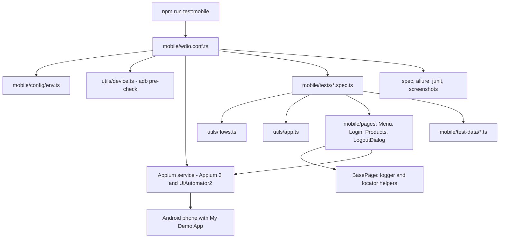

# Mobile Automation Framework (WebdriverIO + Appium + TypeScript)

Application under test: Sauce Labs My Demo App (native Android), package `com.saucelabs.mydemoapp.android` (Login / Logout, user story `US_LOGIN_001`).

---

## A1. Automation tool and framework

| Item | Detail | Configured in |
|---|---|---|
| Automation tool | Appium 3 with the UiAutomator2 driver | `mobile/package.json`, `mobile/wdio.conf.ts` |
| Client / runner | WebdriverIO 9 (`@wdio/cli`, `@wdio/local-runner`) | `mobile/wdio.conf.ts` |
| Test framework | Mocha (`@wdio/mocha-framework`) | `mobile/wdio.conf.ts` `framework: 'mocha'` |
| Assertions | `expect-webdriverio` via `@wdio/globals` | page objects and specs |
| Appium start | `@wdio/appium-service` starts Appium on `APPIUM_PORT` | `mobile/wdio.conf.ts` `services` |
| Design pattern | Page Object Model | `mobile/pages/` |
| Reporting add-ons | `@wdio/spec-reporter`, `@wdio/allure-reporter`, `@wdio/junit-reporter`, `allure-commandline` | `mobile/wdio.conf.ts` |

Execution environment: a physical Android phone connected by USB (verified). Emulator use is possible by setting `ANDROID_UDID` to the emulator serial but was not tested in this project.

The mobile project is a separate package (`"type": "module"`) because WebdriverIO 9 is ESM-only, while the web project at the repository root is CommonJS.

## A2. Programming language and versions

| Item | Version | Source |
|---|---|---|
| TypeScript | 5.9.3 installed (`^5.6.0`), strict mode | `mobile/tsconfig.json`, `mobile/node_modules/typescript` |
| WebdriverIO | 9.32.0 | `mobile/node_modules/webdriverio` |
| `@wdio/mocha-framework` | 9.32.0 | `mobile/node_modules/@wdio/mocha-framework` |
| Appium | 3.8.0 | `mobile/node_modules/appium` |
| UiAutomator2 driver | 8.7.0 | `mobile/node_modules/appium-uiautomator2-driver` |
| Node.js | 22.x (22.22.3 on the development machine) | Appium 3 and WebdriverIO 9 require a recent Node |
| Android platform-tools (`adb`) | Installed on the host | Folder given in `ANDROID_HOME` |
| Java | Needed only to build Allure reports | Installed separately |

## A3. Test execution framework

- Runner: `wdio run wdio.conf.ts` with Mocha (`describe` / `it`, `before` / `after` / `beforeEach`).
- Specs: `./tests/**/*.spec.ts` (`login.spec.ts`, `logout.spec.ts`).
- Instances: `maxInstances: 1` (one device).
- Timeouts: Mocha test timeout 180 s; element wait 10 s (`waitforTimeout`); connection retry count 2.
- Filtering: tags in test titles with `--mochaOpts.grep`.

### Tags (exact syntax is a word in the test title)

| Tag | Purpose | Command (from the repository root) |
|---|---|---|
| `@smoke` | Core paths (7 tests) | `npm run test:mobile:smoke` |
| `@regression` | Regression set | `npm --prefix mobile run test:regression` |
| `@negative` | Negative scenarios | `npm --prefix mobile run test:one -- @negative` |
| `@security` | Security-oriented checks | `npm --prefix mobile run test:one -- @security` |
| `@known-issue` | Application defects (4 tests) | `npm --prefix mobile run test:one -- @known-issue` |

There is no `@sanity` tag on mobile.

Test titles carry the test-case ID, for example `TC_MOB_LOGIN_003 @smoke @regression valid credentials open the products screen`.

## A4. Framework architecture and design pattern



Design rules used in the code:
- A locator is a **factory** (`ElementLocator = () => ChainablePromiseElement`), assigned in each page-object constructor. WebdriverIO starts searching as soon as `$()` is called, so the element is resolved at the moment of use to avoid stale elements after an app restart.
- Members are not `private`.
- Every page-object method logs the start and success with `this.logger.info` and failures with `this.logger.error` in a `catch` block before rethrowing. Passwords are never logged (`type(..., sensitive)`).
- No `browser.pause`; waits use `waitForDisplayed` and `expect-webdriverio`.
- Known application defects are wrapped in `expectKnownIssue()`, which passes while the defect exists and fails once the app is fixed.

## A5. Project folder structure

```
mobile/
  package.json              # scripts and dependencies
  tsconfig.json             # type-check settings
  wdio.conf.ts              # runner, capabilities, services, reporters, hooks
  .env.example              # copy to .env (git-ignored)
  config/
    env.ts                  # typed environment values
  pages/
    BasePage.ts
    MenuPage.ts
    LoginPage.ts
    ProductsPage.ts
    LogoutDialog.ts
  test-data/
    users.ts
    messages.ts
  tests/
    login.spec.ts
    logout.spec.ts
  utils/
    app.ts
    device.ts
    flows.ts
    logger.ts
```

Generated folders (git-ignored): `allure-results/`, `allure-report/`, `reports/`, `screenshots/`.

## A6. Purpose of important folders and classes

### Folders

| Folder | Purpose |
|---|---|
| `mobile/config` | Environment settings |
| `mobile/pages` | Screen (page) objects |
| `mobile/tests` | Mocha specifications |
| `mobile/test-data` | Users, payloads and expected messages |
| `mobile/utils` | App lifecycle, device check, shared flows, logger |

### Classes and modules

| Class / module | Responsibility |
|---|---|
| `BasePage` | `logger`; locator builders `byId`, `bySystemId`, `byAccessibilityId`; `tap(locator, name)` and `type(locator, text, name, sensitive)` with logging |
| `MenuPage` | Locators: "View menu", "Login Menu Item", "Logout Menu Item" (accessibility ids). Methods: `open`, `openLogin`, `tapLogin`, `tapLogout`, `verifyLoginItemVisible`, `verifyLoginItemAbsent`, `verifyLogoutItemVisible`, `verifyLogoutItemAbsent` |
| `LoginPage` | Locators (resource ids): `loginTV`, `nameET`, `passwordET`, `loginBtn`, `nameErrorTV`, `passwordErrorTV`, `username1TV`. Methods: `login`, `enterPassword`, `tapListedBodUser`, `verifyVisible`, `verifyPasswordMasked`, `verifyUsernameFilled`, `verifyPasswordFilled`, `verifyFieldsEmpty`, `verifyUsernameError`, `verifyPasswordError`, `verifyNoPasswordError`, `verifyLoginRejected` |
| `ProductsPage` | Locators: `productTV`, "View cart", "Tap to add product to cart", "Confirms products for checkout". Methods: `verifyVisible`, `verifyNotVisible`, `addFirstProductToCart`, `openCart`, `proceedToCheckout` |
| `LogoutDialog` | Android dialog ids `message`, `button1` (LOGOUT), `button2` (CANCEL). Methods: `verifyVisible`, `verifyClosed`, `confirm`, `cancel` |
| `restartApp`, `terminateApp`, `bringAppToFront`, `expectKnownIssue` (`utils/app.ts`) | App lifecycle and known-issue handling |
| `assertUsableDevice`, `listAdbDevices` (`utils/device.ts`) | Runs `adb devices` before the session starts and fails with a clear message if no device is attached, `ANDROID_UDID` is not listed, or the device name contains a space |
| `menuPage`, `loginPage`, `productsPage`, `loginAsValidUser` (`utils/flows.ts`) | Shared page instances and a reusable login flow |
| `Logger`, `describeError` (`utils/logger.ts`) | Timestamped console log with levels |

Locator verification status: ids used by the login, logout and menu tests were verified against the running app. The locators for the checkout test (`TC_MOB_LOGIN_016`: "Product Image", "Tap to add product to cart", "View cart", "Confirms products for checkout") and `username1TV` (`TC_MOB_LOGIN_005`) come from the app source and need confirmation on a device.

## A7. Test data management

| File | Content |
|---|---|
| `mobile/test-data/users.ts` | Valid, locked-out, wrong-password and unknown users (public demo accounts from the assignment) and the payloads used (SQL string, whitespace) |
| `mobile/test-data/messages.ts` | Expected messages (for example "Username is required", "Enter Password", the locked-out text, the logout dialog text) |
| `mobile/.env` | Device and app settings (git-ignored); `.env.example` is tracked |

- Login state is held in memory by the app, so each test restarts the app to start logged out. The test device denies `pm clear`, so data is not cleared with it.

## A8. Reporting framework

| Reporter | Output | Use |
|---|---|---|
| `spec` | Terminal | Live results |
| `allure` | `mobile/allure-results/` | Allure report data |
| `junit` | `mobile/reports/junit/results-<cid>.xml` | Jenkins test results |

- Failure screenshots: the `afterTest` hook in `wdio.conf.ts` saves `mobile/screenshots/<test name>.png` and attaches it to Allure.
- Report commands: `npm run report:mobile` (from the repository root) or `npm run report` inside `mobile/`; `npm run report:all` merges web and mobile results.

## A9. Reusable utilities and configuration management

- `mobile/config/env.ts` reads `mobile/.env`: `ANDROID_UDID`, `DEVICE_NAME`, `APP_PACKAGE`, `APP_ACTIVITY`, `APP_PATH`, `APPIUM_PORT`, `LOG_LEVEL`. `ANDROID_HOME` and `ANDROID_SDK_ROOT` are also read from the environment by Appium and by `utils/device.ts`.
- `mobile/wdio.conf.ts` builds the capabilities from those values.
- Utilities: `app.ts`, `device.ts`, `flows.ts`, `logger.ts`.
- Type check: `npm --prefix mobile run typecheck`.

## A10. Driver initialization and teardown

| Stage | What happens | Where |
|---|---|---|
| Pre-check | `onPrepare` calls `assertUsableDevice()` (runs `adb devices`) | `wdio.conf.ts`, `utils/device.ts` |
| Appium server | `@wdio/appium-service` starts Appium on `APPIUM_PORT` | `wdio.conf.ts` `services` |
| Session creation | WebdriverIO creates the session with capabilities: `platformName Android`, `appium:automationName UiAutomator2`, `appium:deviceName`, optional `appium:udid` and `appium:app`, `appium:appPackage`, `appium:appActivity`, `appium:appWaitActivity '*'`, `appium:noReset true`, `appium:autoGrantPermissions true`, `appium:newCommandTimeout 300` | `wdio.conf.ts` `capabilities` |
| Suite start | `before` hook logs and calls `restartApp()` | `tests/*.spec.ts` |
| Per test | `beforeEach` calls `restartApp()` (terminate, activate, wait for the Products title); `logout.spec.ts` then calls `loginAsValidUser()` | `tests/*.spec.ts`, `utils/app.ts` |
| On failure | `afterTest` saves and attaches a screenshot | `wdio.conf.ts` |
| Suite end | `after` hook calls `terminateApp()` | `tests/*.spec.ts` |
| Session end | WebdriverIO deletes the session and stops Appium | `@wdio/local-runner`, `@wdio/appium-service` |

Why `noReset: true`: the test phone denies `pm clear` (the `CLEAR_APP_USER_DATA` permission), so a full reset fails; the app is restarted instead.

---

## Part B: Steps to run the Mobile project

### B1. Prerequisites
- Node.js 22.x and npm
- Git
- Android platform-tools (`adb`); on macOS with Homebrew the folder was `/opt/homebrew/Caskroom/android-platform-tools/<version>`
- An Android phone with Developer options and USB debugging on, connected by USB cable
- My Demo App installed on the phone (from https://github.com/saucelabs/my-demo-app-android/releases), or `APP_PATH` set to the APK
- Java (only for Allure reports)

### B2. Clone the repository
```bash
git clone https://github.com/raaj177/SnapWork_Assigmnt.git
cd SnapWork_Assigmnt
```

### B3. Install dependencies
```bash
cd mobile
npm install
```

### B4. Environment configuration
```bash
cp .env.example .env
```
Edit `mobile/.env`:
```
ANDROID_HOME=<folder that contains platform-tools/adb>
ANDROID_SDK_ROOT=<same folder>
ANDROID_UDID=<serial shown by adb devices, no spaces>
DEVICE_NAME=Android Device
APP_PACKAGE=com.saucelabs.mydemoapp.android
APP_ACTIVITY=com.saucelabs.mydemoapp.android.view.activities.SplashActivity
APP_PATH=
APPIUM_PORT=4723
LOG_LEVEL=info
```

### B5. Android device / emulator setup
1. Enable Developer options and USB debugging on the phone.
2. Connect the phone with a USB cable and accept the debugging prompt.
3. Check the connection (the serial must not contain spaces):
   ```bash
   adb devices
   ```
   Expected: one line such as `<serial>   device`. Put that serial in `ANDROID_UDID`.
4. Unlock the phone and keep the screen on during the run.

Wireless debugging device names can contain a space (for example `adb-...(2)._adb-tls-connect._tcp`), which Appium cannot match. Use USB or `adb connect <ip>:<port>`.

Emulator (not tested in this project): start an Android Virtual Device and set `ANDROID_UDID` to its serial from `adb devices` (for example `emulator-5554`).

### B6. Appium server setup
Appium is installed by `npm install` and started automatically by the WebdriverIO Appium service. Install the driver once:
```bash
npm run setup          # appium driver install uiautomator2
npx appium driver list --installed     # optional check
```
Manual start (optional, for debugging): `npx appium` inside `mobile/`.

### B7. Run tests

| Goal | Command (inside `mobile/`) | From the repository root |
|---|---|---|
| One test | `npm run test:one -- TC_MOB_LOGIN_003` | `npm --prefix mobile run test:one -- TC_MOB_LOGIN_003` |
| Smoke | `npm run test:smoke` | `npm run test:mobile:smoke` |
| Regression | `npm run test:regression` | `npm --prefix mobile run test:regression` |
| Full mobile suite | `npm test` | `npm run test:mobile` |
| Web then mobile | - | `npm run test:all` |
| Type check | `npm run typecheck` | `npm --prefix mobile run typecheck` |

### B8. Reports

| Report | Command |
|---|---|
| Mobile Allure (generate and open) | `npm run report` inside `mobile/`, or `npm run report:mobile` from the root |
| Combined web and mobile Allure | `npm run report:all` from the root |
| JUnit | `mobile/reports/junit/*.xml` |
| Failure screenshots | `mobile/screenshots/` |

### B9. Jenkins
See [jenkins_setup.md](jenkins_setup.md). The pipeline file is `jenkins/Jenkinsfile.mobile`; it must run on the machine that has the phone attached.

### B10. Troubleshooting

| Symptom | Cause | Fix |
|---|---|---|
| `wdio: command not found` | Dependencies not installed in `mobile/` | `npm install` inside `mobile/` |
| `ERESOLVE` for `expect-webdriverio` | Version mismatch | `mobile/package.json` pins `^6.0.9` |
| `uiautomator2 cannot be installed ... server version` | Driver needs Appium 3 | `mobile/package.json` uses `appium ^3.0.0` |
| `Device ... was not in the list of connected devices` | Device name with a space, or the phone disconnected | `adb devices`; use USB or an IP connection; the pre-check explains this |
| `pm clear ... CLEAR_APP_USER_DATA` | Device blocks clearing app data | Already handled with `noReset: true` and app restart |
| No device found | Cable, USB debugging, or unlocked screen | Reconnect and run `adb devices` |
