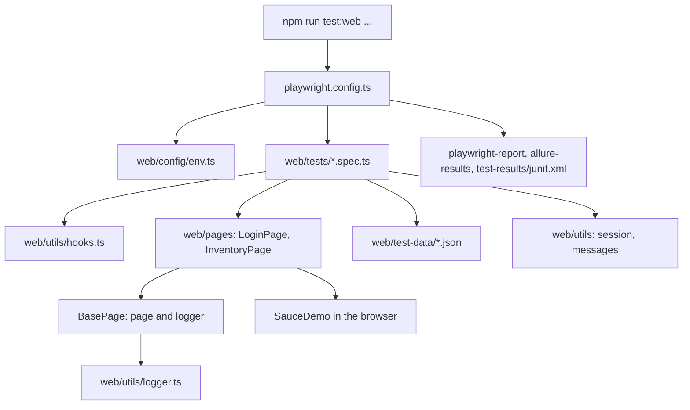

# Web Automation Framework (Playwright + TypeScript)

Application under test: SauceDemo, https://www.saucedemo.com/ (Login / Logout, user story `US_LOGIN_001`).

---

## A1. Automation tool and framework

| Item | Detail | Configured in |
|---|---|---|
| Automation tool | Playwright (`@playwright/test`) | `package.json`, `playwright.config.ts` |
| Browsers | Chromium (default); Firefox and WebKit only for tests tagged `@cross-browser` | `playwright.config.ts` `projects` |
| Design pattern | Page Object Model | `web/pages/` |
| Reporting add-ons | `allure-playwright`, `allure-commandline`, built-in HTML and JUnit reporters | `playwright.config.ts`, `package.json` |
| Configuration | `dotenv` | `web/config/env.ts` |

## A2. Programming language and versions

| Item | Version | Source |
|---|---|---|
| TypeScript | 5.9.3 installed (`^5.6.0` in `package.json`), strict mode | `tsconfig.json`, `node_modules/typescript` |
| Playwright Test | 1.64.0 | `node_modules/@playwright/test` |
| allure-playwright | 3.13.0 | `node_modules/allure-playwright` |
| Node.js | 22.x (22.22.3 on the development machine) | Jenkins tool `NodeJS-22` should point to a 22.x release |
| Java | Needed only to build Allure reports | Installed separately |

## A3. Test execution framework

- Runner: **Playwright Test**. Specs are `web/tests/*.spec.ts`.
- Test location: `testDir: './web/tests'` in `playwright.config.ts`.
- Parallelism: `fullyParallel: true`; workers default locally, `2` when `CI` is set.
- Retries: `0` locally, `1` when `CI` is set.
- Timeouts: test 30 s, `expect` 7 s, action 10 s.
- Filtering: tags written in test titles, matched with `--grep` (see "Tags" below).

### Tags (exact syntax is a word in the test title)

| Tag | Purpose | Command |
|---|---|---|
| `@smoke` | Core paths | `npm run test:web:smoke` |
| `@sanity` | Quick check (8 smoke tests plus the 5 flows in `sanity.spec.ts`) | `npm run test:web:sanity` |
| `@regression` | Full regression set | `npm run test:web:regression` |
| `@negative` | Negative scenarios | `npx playwright test --grep @negative` |
| `@security` | Security-oriented checks | `npx playwright test --grep @security` |
| `@known-issue` | Application defect; test asserts the expected behavior and is marked as an expected failure | `npx playwright test --grep @known-issue` |
| `@cross-browser` | Run on Chromium, Firefox and WebKit | `npm run test:web:cross-browser` |

Test titles carry the test-case ID from the Excel workbook, for example `TC_WEB_LOGIN_001 @smoke @sanity @regression valid credentials open the inventory page`.

## A4. Framework architecture and design pattern

Pattern: **Page Object Model** with shared helpers and per-spec hooks.



Design rules used in the code:
- Locators are created in each page-object constructor with `getByRole(...)`; members are not `private`.
- Page objects expose intent-level methods (`login`, `logout`) and `verify...` methods used by `sanity.spec.ts`.
- Every page-object method logs the start and the success with `this.logger.info`, and logs failures with `this.logger.error` in a `catch` block before rethrowing. Polled getters use `debug`.
- No hard waits (`waitForTimeout`); Playwright auto-waiting and `expect` / `expect.poll` are used.

## A5. Project folder structure

```
SnapWork/
  package.json              # scripts and dependencies
  playwright.config.ts      # runner configuration
  tsconfig.json             # type-check settings (web/ and the config file)
  .env.example              # BASE_URL, HEADLESS, LOG_LEVEL
  web/
    config/
      env.ts                # loads .env, exports env and sessionCookieName
    fixtures/
      pages.fixture.ts      # present, not imported by any spec
    pages/
      BasePage.ts
      LoginPage.ts
      InventoryPage.ts
    test-data/
      users.json
      messages.json
      login-cases.json
    tests/
      login.spec.ts
      logout.spec.ts
      security.spec.ts
      sanity.spec.ts
    utils/
      hooks.ts
      logger.ts
      messages.ts
      session.ts
```

Generated folders (git-ignored): `playwright-report/`, `allure-results/`, `allure-report/`, `test-results/`.

## A6. Purpose of important folders and classes

### Folders

| Folder | Purpose |
|---|---|
| `web/config` | Environment settings |
| `web/pages` | Page objects |
| `web/tests` | Test specifications |
| `web/test-data` | JSON inputs and expected messages |
| `web/utils` | Reusable helpers (hooks, logger, cookies, messages) |
| `web/fixtures` | Contains an unused fixture file |

### Classes and modules

| Class / module | Responsibility |
|---|---|
| `BasePage` (`web/pages/BasePage.ts`) | Holds `page` and `logger`; `navigateTo(path)` with logging |
| `LoginPage` (`web/pages/LoginPage.ts`) | Locators: Username textbox, Login button, `alert` banner, "Dismiss error" button. Actions: `open`, `enterUsername`, `enterPassword`, `submit`, `submitWithEnterKey`, `login`, `loginWithEnterKey`, `dismissError`, `focusPassword`. Queries: `isLoaded`, `isLoginButtonEnabled`, `getUsernameValue`, `getPasswordValue`, `getPasswordFieldType`, `isPasswordMasked`, `getErrorText`, `isErrorVisible`. Checks: `verifyPageVisible`, `verifyPasswordMasked`, `verifyErrorMessage`, `verifyLoggedOut` |
| `InventoryPage` (`web/pages/InventoryPage.ts`) | Locators: "Open Menu", "Logout", "Sort products", "Add to cart" buttons. Methods: `isLoaded`, `getProductCount`, `logout`, `verifyPageVisible` (expects 6 products) |
| `Logger`, `describeError` (`web/utils/logger.ts`) | Timestamped console log with levels `debug`, `info`, `warn`, `error` |
| `createContext`, `attachScreenshotOnFailure` (`web/utils/hooks.ts`) | Browser context creation and the failure screenshot |
| `getSessionCookie`, `setSessionCookie`, `allCookieValues` (`web/utils/session.ts`) | Cookie helpers for session tests |
| `msg` (`web/utils/messages.ts`) | Expected message texts, including the protected-route message |
| `env` (`web/config/env.ts`) | `baseUrl`, `headless`, `logLevel` |

Note about the password field: it has no ARIA role, so `LoginPage.enterPassword` reaches it with the keyboard from the Username field (see the comment in the source).

## A7. Test data management

| File | Content |
|---|---|
| `web/test-data/users.json` | User names for the valid, locked-out and performance-glitch users (public demo accounts from the assignment) |
| `web/test-data/messages.json` | Expected error and redirect messages |
| `web/test-data/login-cases.json` | Data-driven rows for mandatory-field and invalid-credential tests, plus attack payloads |

- Specs read the JSON files directly; no values are hard-coded in specs except small literals.
- `.env` holds environment values and is git-ignored; `.env.example` is tracked.
- Data-driven specs build test titles from the JSON, so the title contains the test-case ID and tags.
- Isolation: `beforeEach` clears cookies before each test. No data is written to the application.

## A8. Reporting framework

| Reporter | Output | Use |
|---|---|---|
| `list` | Terminal | Live progress |
| `html` | `playwright-report/index.html` | Interactive report with attachments |
| `allure-playwright` | `allure-results/` | Allure report data |
| `junit` | `test-results/junit.xml` | Jenkins test results |

- Failure evidence: `attachScreenshotOnFailure` attaches a screenshot to the report in `afterEach`. The config also sets `screenshot: 'only-on-failure'` and `trace: 'retain-on-failure'`, but these apply to pages Playwright creates; the specs create their own page in `beforeAll`, so traces are not captured for those pages.
- Console output uses the logger in `web/utils/logger.ts`; set `LOG_LEVEL=debug` in `.env` for more detail.

## A9. Reusable utilities and configuration management

- Configuration: `web/config/env.ts` reads the root `.env`. Defaults: `BASE_URL=https://www.saucedemo.com`, `HEADLESS=true`, `LOG_LEVEL=info`.
- Runner configuration: `playwright.config.ts`.
- Utilities: `hooks.ts`, `logger.ts`, `messages.ts`, `session.ts` (see A6).
- TypeScript settings: `tsconfig.json` (strict mode); check with `npm run typecheck`.

## A10. Browser initialization and teardown

1. **Browser launch**: the Playwright runner starts the browser per worker and project (headless unless `HEADLESS=false` or `--headed`).
2. **Context and page** (`beforeAll` in each spec): `createContext(browser)` calls `browser.newContext({ baseURL, viewport: 1280x720 })`; then `context.newPage()` and the page objects are constructed.
3. **Per test** (`beforeEach`): `context.clearCookies()` and `loginPage.open()`.
4. **After each test** (`afterEach`): `attachScreenshotOnFailure(page, testInfo)`.
5. **Teardown** (`afterAll`): `context.close()`. The runner closes the browser when the worker ends.

---

## Part B: Steps to run the Web project

### B1. Prerequisites
- Node.js 22.x and npm
- Git
- Java (only for Allure reports): check with `java -version`

### B2. Clone the repository
```bash
git clone https://github.com/raaj177/SnapWork_Assigmnt.git
cd SnapWork_Assigmnt
```
(The URL is the repository used by the Jenkins job in this project.)

### B3. Install dependencies
```bash
npm install
```

### B4. Environment configuration
```bash
cp .env.example .env
```
Edit `.env` if needed:
```
BASE_URL=https://www.saucedemo.com
HEADLESS=true
LOG_LEVEL=info
```

### B5. Browser setup
```bash
npx playwright install chromium
# Optional, for the @cross-browser tests:
npx playwright install firefox webkit
```

### B6. Run tests

| Goal | Command |
|---|---|
| One test | `npm run test:web:one -- TC_WEB_LOGIN_001` |
| One file | `npx playwright test web/tests/login.spec.ts` |
| Sanity | `npm run test:web:sanity` |
| Smoke | `npm run test:web:smoke` |
| Regression | `npm run test:web:regression` |
| Full web suite | `npm run test:web` |
| Visible browser | `npm run test:web:headed` or add `-- --headed` |
| Debug | `npm run test:web:sanity -- --debug` |
| Cross-browser | `npm run test:web:cross-browser` |
| Type check | `npm run typecheck` |

Note: `--grep` matches the test title, so `npm run test:web:smoke` also matches tests whose titles contain `@smoke` in any file.

### B7. Reports

| Report | Command |
|---|---|
| Playwright HTML | `npm run report:web` |
| Allure (web) | `npm run allure:generate` then `npm run allure:open` |
| Allure (web + mobile combined) | `npm run report:all` |
| JUnit | `test-results/junit.xml` |

### B8. Jenkins
See [jenkins_setup.md](jenkins_setup.md). The Web pipeline file is `jenkins/Jenkinsfile.web`.

### B9. Troubleshooting

| Symptom | Cause | Fix |
|---|---|---|
| `First argument must use the object destructuring pattern` | Hook signature | `test.afterEach(async ({}, testInfo) => ...)` (already applied) |
| Browser executable not found | Browsers not installed | `npx playwright install chromium` |
| Empty report | Tests not run yet | Run tests first, then open the report |
| `allure: command not found` or Java error | Java missing | Install Java, check `java -version` |
